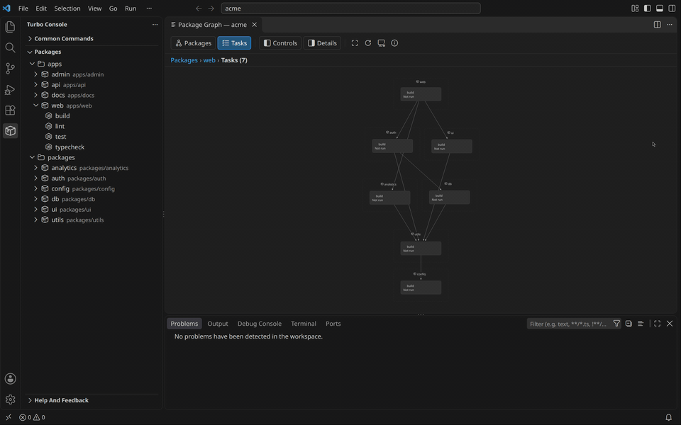

# turbo-console

A VS Code extension for Turborepo workspaces: browse packages and tasks, see the task graph, and run tasks from the editor. Work in progress.

Unofficial. Not affiliated with or endorsed by Vercel or the Turborepo team.

What it does, with more screenshots: [packages/vscode/README.md](packages/vscode/README.md).

`.vscode/settings.json` pins the editor to TypeScript 6 (`node_modules/typescript`): typescript-eslint and editors run on TS 6, while builds and typecheck use TS 7.

## Developer notes

- `engines.vscode`: `^1.144.0` (VS Code stable 1.146.0 minus two minors, checked 2026-11-22; 1.147.0 was 5 days old)
- `@types/vscode`: `1.144.0` (matches `engines.vscode`; vsce rejects `@types/vscode` newer than the engine)
- `@types/vscode` is pinned literally (not via the catalog) because vsce 4.0.0 cannot parse `catalog:` and fails with "Failed to parse semver of @types/vscode".
