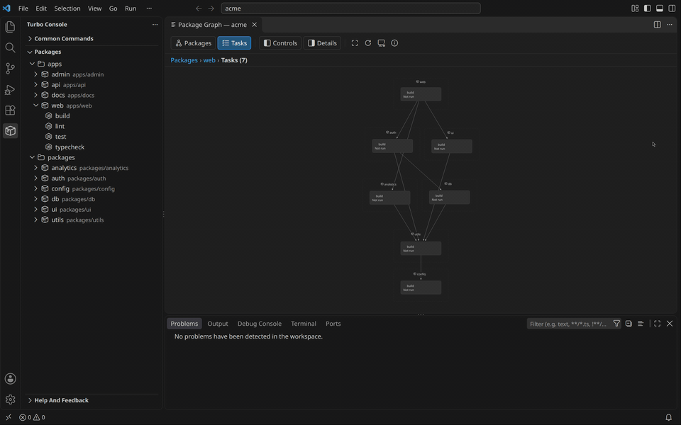
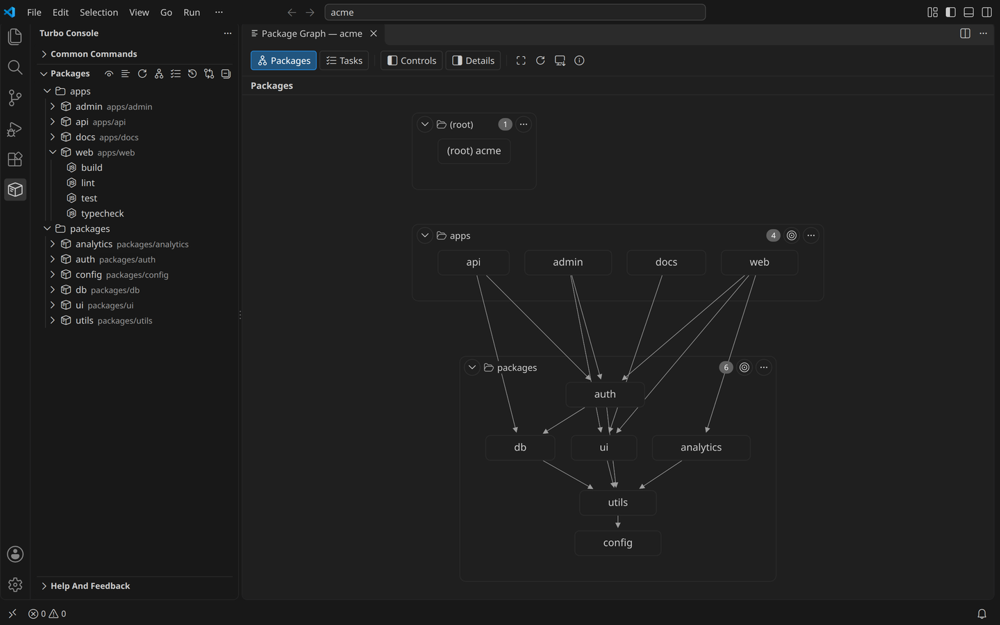
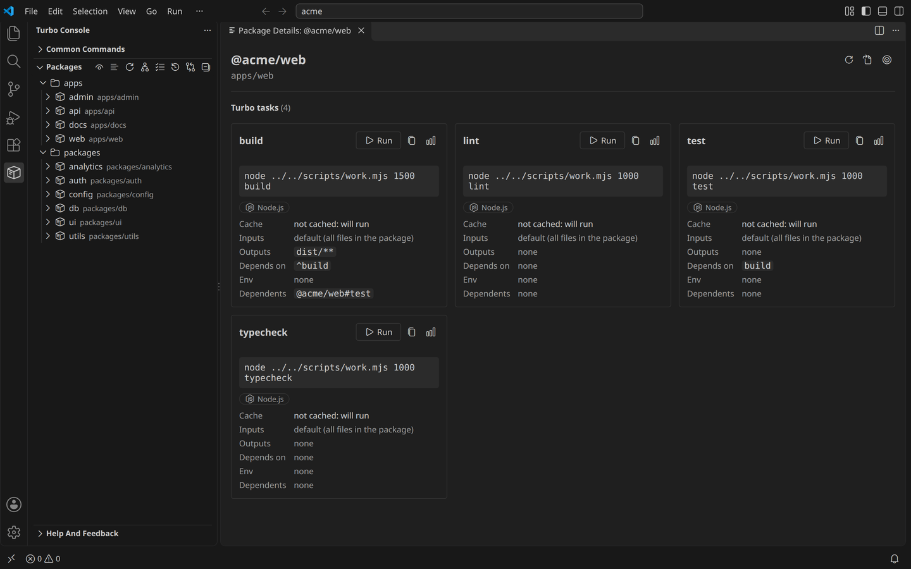
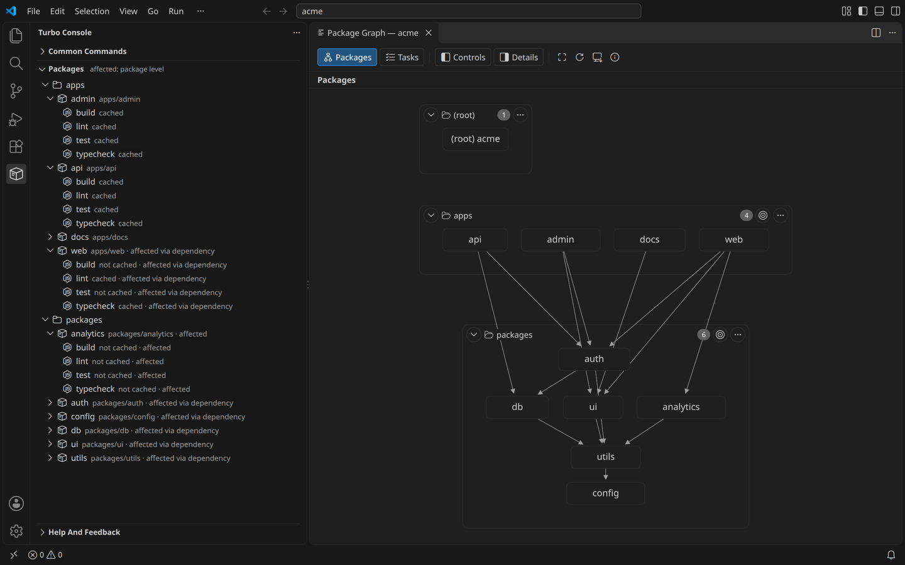

# Turbo Console (unofficial)

Turbo Console is a VS Code extension for Turborepo workspaces. It lists each turbo root's packages and tasks in a sidebar and runs turbo tasks from the editor.

Unofficial. Not affiliated with or endorsed by Vercel or the Turborepo team.

## What it does

- **Packages view:** every package with its tasks, shown as folders or as a flat list (`turboConsole.treeMode`). Folder and package rows follow your file icon theme when it has folder icons (Material Icon Theme, vscode-icons, Minimal). With theme icons, an idle tool row also takes the theme's icon for the tool's config file (such as `vitest.config.ts`) when the theme names that file. `turboConsole.icons` forces it: `theme` always uses the file icon theme, `builtin` always uses Turbo Console's own icons.
- **Run and Stop:** run a task from its row. The row shows how it ended, plus the cache status and duration once turbo's run summary is found.
- **Run Without Turbo:** a task row's context menu runs the task's `package.json` script through your package manager in a terminal, with no dependencies, cache, env filtering or run summary. You can type into it, and its output shows as it is written.
- **Run with Options…:** a task row's menu opens a checklist for one run: without cache, only this task, keep going after a failure, a concurrency, extra arguments after `--` (passed to every task of that name in the run). A script row asks for extra arguments. Arguments use letters, digits and `@ / . _ : = + -`, no spaces or quotes. Script arguments are untested with bun, yarn berry and npm under Windows PowerShell. A concurrency below the number of persistent tasks is turbo's own error.
- **Palette:** Run Task… picks a task and then a package. Run Turbo Task… (also the play button on an open `package.json`) runs one of that package's tasks.
- **Common Commands view:** Run Task in All Packages…, Run Affected… and Refresh.
- **Package and task rows:** Copy Command puts `turbo run <task> --filter=<package>` on the clipboard, quoted for your terminal's shell. Open package.json, Reveal in Explorer and Copy Path are there too.
- **Package Details page:** Open Package Details shows a package's Turbo tasks and Scripts as cards with their cache status and run state.
- **Package and Task Graph:** Show Package Graph and Show Task Graph… draw the dependency graphs, with run state and a live clock on task cards.
- **Show Cache Prediction and Show Affected:** the first marks which tasks turbo would replay from cache, the second marks the packages your changes touch.
- **Help and Feedback view:** links to the project page on GitHub, the bug tracker and the Turborepo docs.

## Screenshots

The Packages view beside the Package Graph:

The Package Details page:

Show Affected, after an edit in one package:

## Good to know

- A run from a task row or from Run Turbo Task… passes `--summarize`, so turbo adds one file per run to `.turbo/runs` in your workspace. Turbo never prunes that folder and the extension never deletes it. Run Task in All Packages… and Run Affected… do not write a summary.
- Turbo's default `stream` UI never passes what you type to a task, and shows a line of output only once that line is complete. For a script that prompts or streams output, use Run Without Turbo. Turbo Console's runs pass no `--ui`, so a `"ui"` set in your `turbo.json` applies; turbo's `tui` passes input only to a task marked `interactive`, once you focus it.
- Run Affected… needs a git repository, because turbo works out what changed from git.
- `turboConsole.turboPath` is machine-scoped: set it in your user settings. A workspace's `.vscode/settings.json` cannot change which turbo binary runs.

## Requirements

VS Code 1.139 or later. turbo 2.11.7 or a later 2.11 release, installed in the workspace (`node_modules/turbo`) or set in `turboConsole.turboPath`.
